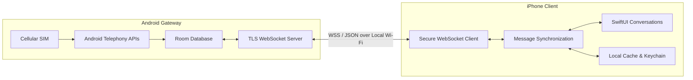
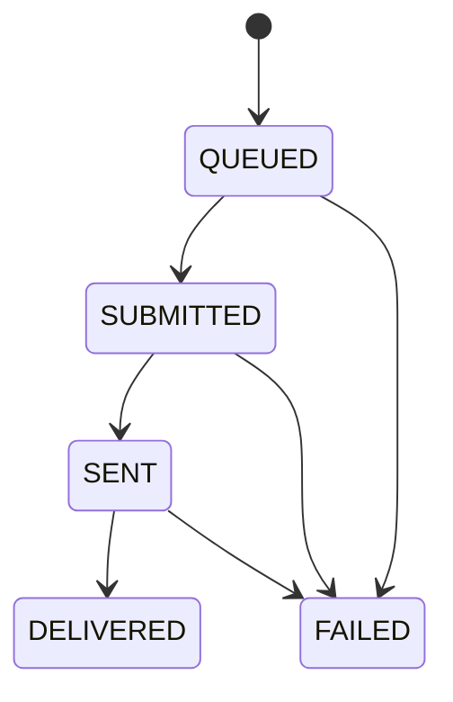

# 📱 Android-to-iPhone SMS Bridge

**Turn your iPhone into a cellular SMS client powered by your Android phone.**

A native, privacy-focused SMS bridge that lets you send and receive real cellular SMS messages on your iPhone using the SIM card installed in an Android device — directly over your local Wi-Fi network or Android hotspot.

No cloud servers. No third-party messaging services. No subscription fees.

Built with **Kotlin, Jetpack Compose, Swift, and SwiftUI**, this project combines native mobile development, cellular telephony, secure networking, and reliable message synchronization in a single personal-use system.

<p align="center">

  **Android Gateway** · **iOS Client** · **End-to-End Local Communication**

</p>

---

## ✨ Highlights

- 📩 **Real Cellular SMS** — Send and receive SMS through your Android phone's SIM card.
- 🔒 **TLS Certificate Pinning** — Authenticate the Android gateway using a SHA-256 certificate fingerprint exchanged during pairing.
- 📡 **Local-First Architecture** — Communicate over local Wi-Fi or an Android hotspot without a cloud backend.
- 🔗 **Secure Device Pairing** — Pair devices using a QR code and a short-lived pairing token.
- 🔄 **Automatic Synchronization** — Recover missed messages when the iPhone reconnects.
- 🛡️ **Duplicate-Send Protection** — Use persistent request IDs to prevent duplicate sends during network retries.
- 🌐 **Persian & Unicode Support** — Handle non-Latin text and estimate SMS segmentation.
- 📲 **Dual-SIM Support** — Detect available SIM subscriptions and select a SIM for outgoing messages.
- 💬 **Native User Interfaces** — Modern Jetpack Compose and SwiftUI interfaces.
- 💾 **Local Persistence** — Store messages and request states on the Android gateway for synchronization and recovery.

> **Project status:** Personal-use MVP. The architecture and feature set described here are intended to be validated through automated tests and physical-device testing. See the testing section for the verification workflow.

---

## 🏗️ Architecture

The system consists of two native applications connected through a shared, versioned JSON protocol.



### How it works

1. Start the bridge on the Android device.
2. Generate a temporary pairing token and display the gateway's certificate fingerprint in a QR code.
3. Scan the QR code from the iPhone and establish a TLS connection.
4. Authenticate the iPhone and store its authorization token securely.
5. Synchronize previously stored messages.
6. Send and receive cellular SMS through the Android gateway while the devices are connected.
7. Recover missed updates when the iPhone reconnects.

**Important:** Cellular SMS travels through the mobile carrier. The local connection transports message requests and results between your devices; it does not replace the carrier's SMS infrastructure.

---

## 🧩 Project Components

### 1. Android Gateway — `/android-gateway`

The Android application acts as the cellular gateway and local WebSocket server.

**Technology stack**

- Kotlin
- Jetpack Compose
- Material 3
- Kotlin Coroutines and Flow
- Room Database
- Android Telephony APIs
- TLS-enabled WebSocket server

**Responsibilities**

- Receive incoming SMS using `SMS_RECEIVED`.
- Parse incoming SMS PDUs and assemble multipart messages.
- Send SMS using `SmsManager`.
- Track radio transmission results and, when supported, carrier delivery reports.
- Detect available SIM subscriptions and route outgoing messages to the selected subscription.
- Persist messages, send requests, and paired-client information.
- Host the local WebSocket endpoint at port `8765`.
- Generate and display the gateway's TLS certificate fingerprint.
- Manage pairing, authentication, reconnection, and synchronization.
- Run a foreground service to support background gateway operation.

### 2. iPhone Client — `/ios-client`

The iOS application provides the messaging interface and communicates with the Android gateway.

**Technology stack**

- Swift
- SwiftUI
- `URLSessionWebSocketTask`
- Swift Concurrency (`async/await`)
- Combine
- AVFoundation
- CryptoKit
- iOS Keychain

**Responsibilities**

- Scan the Android pairing QR code.
- Validate the pinned TLS certificate during connection establishment.
- Store authorization tokens and certificate fingerprints in Keychain.
- Display conversations grouped by phone number.
- Compose and send SMS messages.
- Estimate GSM and Unicode SMS segmentation.
- Display message transmission and delivery states.
- Synchronize missed messages after reconnection.
- Show connection diagnostics and paired-device information.
- Support local-cache management and pairing revocation.

### 3. Shared Protocol — `/shared-protocol`

Both applications use a versioned JSON protocol over a TLS-protected WebSocket connection.

**Endpoint**

```text
wss://<android-ip>:8765/ws
```

**Supported protocol message types**

| Message | Purpose |
|---|---|
| `PAIR_REQUEST` | Initiate device pairing |
| `PAIR_RESPONSE` | Return pairing and authorization information |
| `AUTHENTICATE` | Authenticate an existing paired client |
| `AUTH_RESPONSE` | Return authentication status |
| `CONNECTION_STATUS` | Report gateway connectivity |
| `SMS_INCOMING` | Deliver an incoming SMS event |
| `SMS_SEND_REQUEST` | Request an outgoing SMS |
| `SMS_SEND_RESULT` | Report the send request's status |
| `SMS_DELIVERY_STATUS` | Report carrier delivery status |
| `SYNC_REQUEST` | Request message synchronization |
| `SYNC_RESPONSE` | Return synchronized messages |
| `ERROR` | Report protocol or processing errors |

Protocol documentation:

- `shared-protocol/PROTOCOL.md`
- `shared-protocol/protocol.json`

---

## 🔐 Security Design

Security is a core part of the bridge architecture.

### TLS certificate pinning

The Android gateway uses a self-signed X.509 certificate. Its SHA-256 fingerprint is displayed in the pairing QR code and transferred to the iPhone through the initial pairing workflow.

The iOS client is designed to compare the presented server certificate against the stored pin and reject certificates that do not match.

**TLS certificate validation must never be disabled to make the connection work.**

### Device pairing

- Pairing tokens expire after five minutes.
- Authorization tokens are issued after successful pairing.
- Existing clients must authenticate before accessing protected protocol operations.
- Pairing can be revoked to prevent future access.

### Local-first data handling

- No cloud backend is required by the architecture.
- Messages are persisted locally on the Android gateway.
- iOS authorization credentials are stored in Keychain.
- Communication between the devices uses the local network.

### Security considerations

Certificate pinning is only one part of a secure implementation. Before relying on the bridge for sensitive communications, verify:

- Server certificate validation and hostname or endpoint binding.
- Token entropy, expiration, revocation, and secure storage.
- Authentication on every protected WebSocket operation.
- Protection against replayed requests and unauthorized message injection.
- Database and local-cache exposure.
- Network binding, firewall behavior, and device trust.
- Correct TLS configuration and secure error handling.

The QR-code pairing flow is intended to establish trust between devices. Its actual security depends on the complete implementation and testing of the pairing and authentication protocol.

---

## 📩 SMS Delivery Lifecycle

The bridge distinguishes between accepting a request, transmitting an SMS, and receiving a delivery report.



| State | Meaning |
|---|---|
| `QUEUED` | The iPhone has recorded the outgoing request locally. |
| `SUBMITTED` | The Android gateway has accepted the request and submitted it to the telephony API. |
| `SENT` | Android received a successful SMS transmission callback. |
| `DELIVERED` | A carrier delivery report was received, when supported. |
| `FAILED` | A reported error prevented the requested operation from succeeding. |

### Idempotency and retry safety

Each outgoing request carries a unique `requestId`, such as:

```text
req_iphone_<UUID>
```

The Android gateway stores request state and uses the identifier to recognize retries.

If the iPhone loses its connection while sending a message, it can query the existing request's status rather than blindly issuing another send operation.

**Implementation note:** Exactly-once SMS transmission cannot be guaranteed solely through an application-level request ID. A crash or connection loss between the cellular send operation and durable status recording can leave the outcome uncertain. The implementation must explicitly handle that state to minimize duplicate messages.

---

## 📲 Android Permissions & SMS Role

The gateway is designed to use Android's SMS permissions without automatically replacing the user's default messaging application.

| Permission | Purpose |
|---|---|
| `RECEIVE_SMS` | Receive incoming SMS broadcasts |
| `SEND_SMS` | Submit outgoing cellular SMS |
| `READ_PHONE_STATE` | Access relevant telephony and subscription information |
| `FOREGROUND_SERVICE` | Run a foreground service |
| `FOREGROUND_SERVICE_CONNECTED_DEVICE` | Support the relevant connected-device foreground-service configuration on Android 14+ |
| `POST_NOTIFICATIONS` | Display foreground-service notifications where applicable |

Permissions and service declarations must match the target Android version and the exact implementation.

### Why not automatically become the default SMS app?

The goal is to preserve the existing messaging application's role wherever Android permits.

A non-default SMS application may send SMS with the appropriate permission and receive `SMS_RECEIVED` broadcasts, subject to platform behavior and device restrictions. However, it generally cannot write outgoing messages into the system SMS provider like the default SMS application.

Consequently, messages sent through the bridge may not appear in Google Messages on the Android device.

For a personal-use installation, review the permissions and role implications before enabling the gateway.

---

## 🔄 Synchronization & Offline Recovery

The Android gateway stores messages and request states so that the iPhone can recover missed updates.

The intended synchronization workflow is:

1. The iPhone connects and authenticates.
2. It submits a `SYNC_REQUEST` with its current synchronization cursor.
3. The Android gateway returns relevant missed messages and state updates.
4. The iPhone updates its local cache.
5. Subsequent synchronization requests use an updated cursor.

This design supports recovery after temporary Wi-Fi interruptions without requiring a cloud database.

### iOS background limitation

iOS can suspend applications running in the background. The client cannot assume that its WebSocket connection will remain active indefinitely when the application is suspended or terminated.

Incoming SMS messages can be stored on Android and synchronized when the iPhone client reconnects, typically when the application returns to the foreground.

**This project does not promise continuous background SMS notifications on iOS.** Achieving remote or reliable background notification delivery would require a different architecture and potentially additional infrastructure.

---

## 🌐 Network Requirements

The devices must be able to reach each other over a local network.

Supported setups include:

- Both devices connected to the same Wi-Fi network.
- The iPhone connected to the Android phone's hotspot.

The bridge does not require a public server, domain name, or cloud database.

### Troubleshooting connectivity

If the iPhone cannot connect:

- Confirm that both devices are on the same reachable network.
- Find the Android device's current local IP address.
- Confirm that the gateway service is running and listening on port `8765`.
- Check firewall rules and client isolation settings on the Wi-Fi network.
- Confirm that the certificate fingerprint matches the QR code.
- Check local-network permissions on iOS.
- Review gateway diagnostics and authentication errors.

Network isolation, hotspot routing, and Android battery-management policies may affect connectivity.

---

## 🛠️ Tech Stack

| Area | Technologies |
|---|---|
| Android | Kotlin, Jetpack Compose, Material 3 |
| iOS | Swift, SwiftUI |
| Networking | TLS, WebSockets, JSON |
| Android persistence | Room Database |
| iOS secure storage | Keychain, CryptoKit |
| iOS local storage | Local JSON cache |
| Telephony | `SmsManager`, SMS broadcasts, `SubscriptionManager` |
| Concurrency | Kotlin Coroutines, Swift Concurrency |
| QR scanning | AVFoundation |
| Protocol testing | Python |

---

## 📁 Project Structure

```text
/
├── android-gateway/
│   ├── app/
│   │   ├── src/main/
│   │   └── build.gradle.kts
│   └── build.gradle.kts
│
├── ios-client/
│   ├── SMSBridgeApp.swift
│   ├── Models/
│   ├── Network/
│   ├── Storage/
│   ├── Views/
│   └── Info.plist
│
├── shared-protocol/
│   ├── PROTOCOL.md
│   └── protocol.json
│
├── docs/
│   ├── PERMISSIONS_AND_ROLES.md
│   ├── TEST_CHECKLIST.md
│   └── IOS_BUILD_GUIDE.md
│
├── tests/
│   └── test_protocol_and_bridge.py
│
└── README.md
```

---

## 🚀 Getting Started

### Prerequisites

**Android gateway**

- Android Studio
- A compatible Android smartphone
- An active SIM card
- USB debugging and ADB for installation, if needed
- Required runtime permissions granted

**iPhone client**

- A Mac running a compatible version of Xcode
- An iPhone for physical-device testing
- An Apple Developer account or eligible free Apple ID signing setup
- Local-network and camera permissions

**Network**

- A reachable local Wi-Fi network or Android hotspot

### 1. Clone the repository

```bash
git clone <your-repository-url>
cd <repository-directory>
```

Replace the placeholder with the actual repository URL.

### 2. Build the Android gateway

Open the `android-gateway` directory in Android Studio, or run the Gradle wrapper from the project root:

```bash
cd android-gateway
```

On Windows:

```powershell
.\gradlew.bat assembleDebug
```

On macOS or Linux:

```bash
./gradlew assembleDebug
```

If the build succeeds, the debug APK is normally generated at:

```text
android-gateway/app/build/outputs/apk/debug/app-debug.apk
```

Install it using ADB:

```bash
adb install -r app/build/outputs/apk/debug/app-debug.apk
```

Grant the requested permissions and start the gateway.

### 3. Configure the iOS client

Follow `docs/IOS_BUILD_GUIDE.md`.

1. Open the iOS project in Xcode.
2. Configure the signing team and bundle identifier.
3. Connect the iPhone.
4. Build and run the app on the physical device.
5. Grant camera and local-network permissions when requested.

The exact project-opening instructions depend on the repository's actual Xcode project configuration.

### 4. Pair the devices

1. Start the gateway on Android.
2. Open its pairing screen.
3. Scan the displayed QR code on the iPhone.
4. Verify the TLS certificate pin.
5. Complete pairing and authentication.
6. Confirm that initial synchronization succeeds.

### 5. Test cellular SMS

Use a test phone number you control.

- Send an SMS from the iPhone through the Android SIM.
- Reply to that number and verify that the incoming message reaches the bridge.
- Test Persian and other Unicode text.
- Test a multipart message.
- Disconnect and reconnect the local network.
- Verify message state transitions and synchronization.

---

## 🧪 Testing

The repository includes a Python protocol and bridge test suite.

Run it from the repository root:

```bash
python tests/test_protocol_and_bridge.py -v
```

The intended test coverage includes:

- Protocol message validation
- Pairing and authentication flows
- TLS pinning behavior
- Request idempotency
- Unicode and Persian text handling
- Message synchronization and recovery

**Important:** Passing a standalone test suite does not prove that real SMS transmission, carrier delivery reports, background execution, or TLS behavior work on every physical device. Validate these separately.

### Physical-device testing

Use `docs/TEST_CHECKLIST.md` for the planned 17-scenario test workflow.

At minimum, test:

- Incoming and outgoing SMS
- Dual-SIM selection
- Long and multipart messages
- Persian text
- Invalid destinations and radio errors
- Lost network connections
- Duplicate-request recovery
- Certificate mismatch rejection
- Pairing revocation
- Background service behavior

---

## ⚠️ Known Limitations

- **Android SMS provider:** Outgoing bridge messages may not appear in the default Android messaging app unless the gateway has the appropriate SMS-provider role and implementation.
- **iOS background execution:** The client cannot guarantee a continuously active socket while suspended.
- **Local network only:** Both devices need a reachable network path; this is not a remote-access solution by default.
- **Carrier dependency:** SMS delivery, delivery reports, encoding, segmentation, and charges depend on the carrier and destination.
- **Device compatibility:** Telephony permissions, dual-SIM behavior, foreground services, and battery restrictions vary by Android version and manufacturer.
- **No MMS guarantee:** The MVP focuses on SMS and does not promise MMS support.
- **Physical-device validation:** Hardware-dependent behavior must be tested on real devices and SIM cards.
- **Delivery semantics:** A successful radio submission is not the same as confirmed delivery to the recipient.

---

## 🗺️ Roadmap

Potential future improvements:

- [ ] Expand automated protocol and integration coverage.
- [ ] Add stronger crash recovery for uncertain SMS send outcomes.
- [ ] Improve message search, filtering, and conversation management.
- [ ] Add richer diagnostics for network and telephony failures.
- [ ] Improve handling of multipart messages and carrier-specific encoding.
- [ ] Add robust persistence and migration tests.
- [ ] Improve compatibility across Android manufacturers and dual-SIM devices.
- [ ] Add optional encrypted local backups.
- [ ] Evaluate notification strategies that respect iOS background-execution restrictions.

---

## 🎯 Project Goals

This project explores the intersection of:

- Native Android and iOS development
- Cellular telephony APIs
- Secure local networking
- TLS certificate pinning
- Device pairing and authentication
- Distributed state synchronization
- Idempotent request processing
- Unicode message handling
- Mobile background execution

It is designed as a practical learning and engineering project focused on connecting two mobile platforms without depending on a cloud messaging service.

---

## 🤝 Contributing

Contributions, bug reports, compatibility findings, and security reviews are welcome.

When reporting an issue, include:

- Android version and device model
- iOS version and iPhone model
- Network setup
- Steps to reproduce the issue
- Relevant logs with tokens, phone numbers, and other sensitive data removed

For security-sensitive findings, avoid publishing exploitable details before coordinating a responsible disclosure.

---

## 📄 License

No license has been specified yet.

Add a `LICENSE` file before distributing the project or accepting contributions. Until then, do not assume that the repository is licensed for unrestricted reuse.

---

<p align="center">

  **Built for privacy. Powered by your SIM. Connected locally.**

</p>
